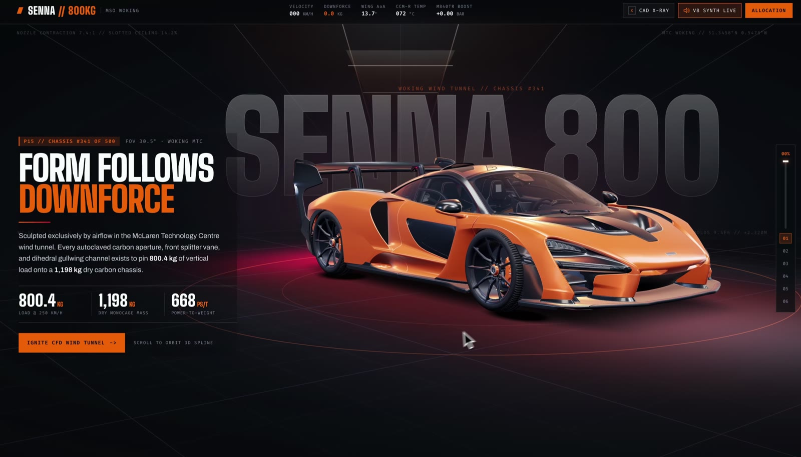

# Senna 800KG

A cinematic scroll film around a McLaren Senna in a wind tunnel. You scroll and the camera travels the car through six acts. Airflow lines wrap the body, an X-ray view opens it up, you can rev the V8 and repaint the car.

[**Try it live**](https://sam1983aing.github.io/senna-800kg/) · [**The prompt**](PROMPT.md) · [**44 second clip**](media/senna-demo.mp4)



**This is a first iteration, on purpose.** I asked Google Antigravity (Gemini 4 Argon, High) for 5 landing pages with no topic, only what I wanted from them. It picked the topics. I never asked for a car. It found this model in one of my older projects and built the page around it. I gave no feedback before this version, and I haven't polished it.

So take it apart and remix it. That's why it's here. MIT for the code. The model has its own license, see the credits below and [NOTICE](NOTICE).

## Try it

Best on a laptop, with the sound on.

- Scroll. Six acts on one camera path, from the nose splitter to the rear wing.
- Press `X` for the X-ray view with labelled parts.
- Move the wind speed and watch the airflow lines react.
- Hold `Space` in the engine act to rev the V8. The sound is synthesised, there are no audio files.
- Pick a livery and a caliper colour in the studio act.

## How it's made

Three.js, TypeScript and Vite. About 5,700 lines of code, written by the agent.

- **`src/three/sennaCar.ts`** loads the model and repaints it, with a clearcoat on the paint and a glow on the brake discs that follows the speed.
- **`src/three/cfdStreamlines.ts`** draws 56 airflow lines. It samples the car's real silhouette from above with raycasts, so the lines bend around this car. It's a visual, not a real air simulation.
- **`src/three/cameraSpline.ts`** is the camera path the scroll drives.
- **`src/three/studioEnv.ts`** generates the studio reflections in code, so there's no HDRI file.
- **`src/audio/v8Audio.ts`** is the engine and turbine sound, built with the Web Audio API.
- **`src/data/msoConfigs.ts`** holds the liveries and the copy for each act.

The agent ran one session per page, took screenshots of its own work in headless Chrome, scored them and went another round. All 5 pages took about an hour.

## Run it locally

```bash
npm install
npm run dev
```

Then open http://127.0.0.1:5405. `npm run build` writes the static site to `docs/`, which is what GitHub Pages serves. The page needs a network connection for its Google Fonts.

## What changed from the original build

Only what publishing needed: relative paths for GitHub Pages, and the credit and concept lines in the footer and the form. The design and the code are as the agent left them.

## Credits and legal

- **3D model:** ["McLaren Senna Free"](https://sketchfab.com/3d-models/mclaren-senna-free-ea3e43a6eb004853a87fe9c58422eb96) by [Black Snow](https://sketchfab.com/BlackSnow02), [CC BY 4.0](https://creativecommons.org/licenses/by/4.0/). Compressed with Draco and re-exported. Keep this credit if you reuse the model. Gemini didn't find it online for this page. It reused a copy from one of my older projects, which had been downloaded from [a public GitHub repo](https://github.com/Sunil56224972/Wretched-Lab-Nfs-Unbound-Virtual-Lab). That copy still had the Sketchfab credit inside the file, which is how I traced it back to Black Snow.
- **Draco decoder:** Google, Apache 2.0.
- **Not official.** This is an unofficial design concept, not affiliated with or endorsed by McLaren. McLaren and Senna are their owners' trademarks. Replace them before using this for anything commercial. Prices, chassis numbers and some specs on the page are made up by the agent, so don't quote them.
- **The form sends nothing.** The name and email fields stay in your browser, and the confirmation is for show.
